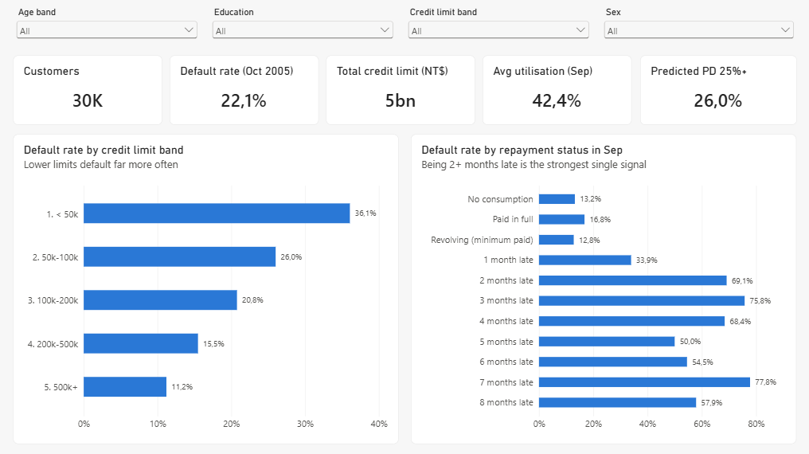
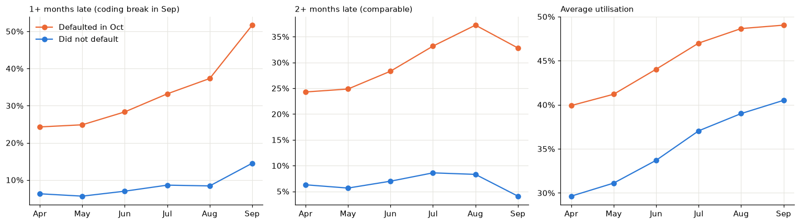
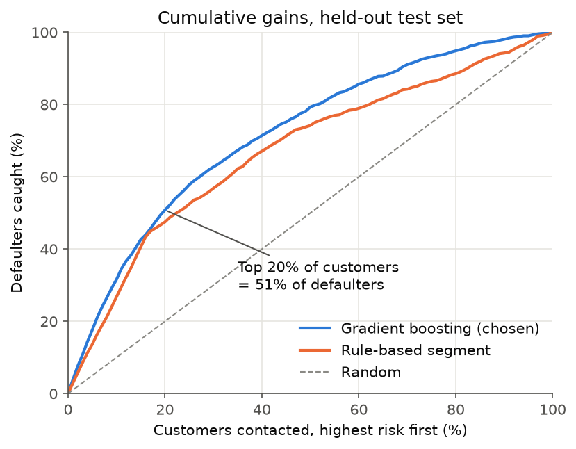
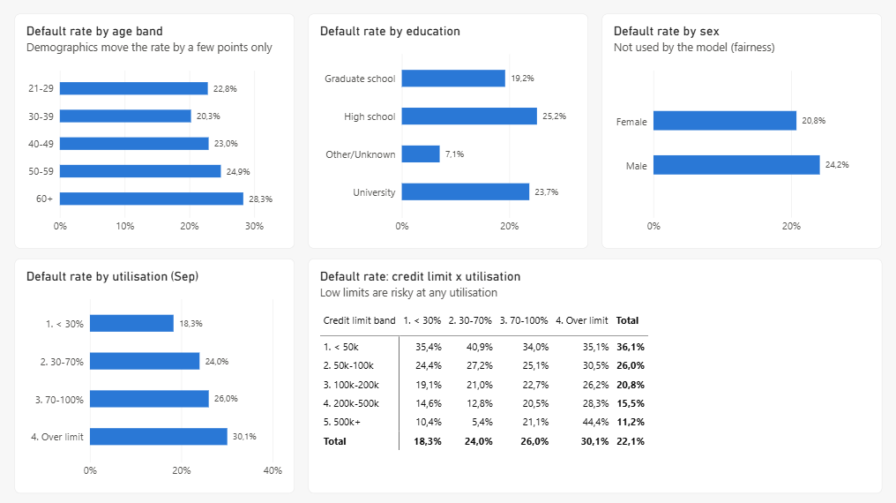
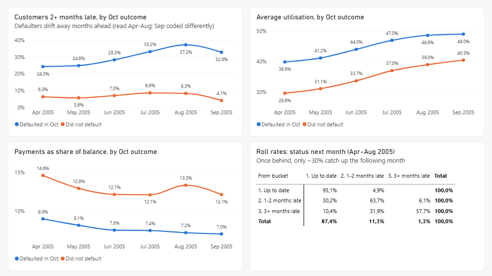
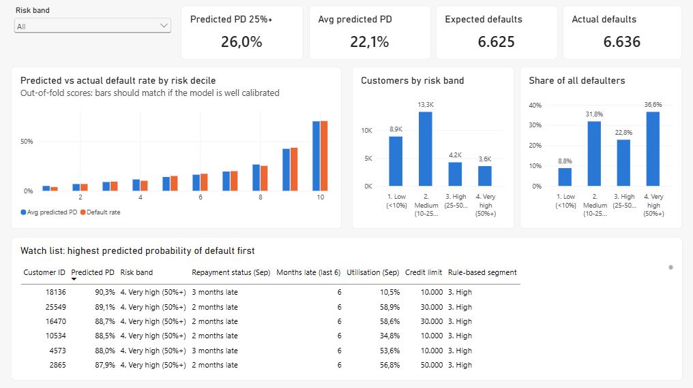

# Banking Credit Risk Analytics

**Who is going to miss their next credit card payment, and could the bank have seen it coming?**

I took 30,000 credit card customers with six months of statements and followed the trail from raw file to a
SQL Server warehouse, a Power BI dashboard and a default prediction model. The goal was to answer three
questions a retail credit risk team asks every month:

1. Which customer segments carry the most risk?
2. How does repayment behaviour change in the months before a default?
3. Which customers are likely to default next month?

**Stack:** Python (pandas, scikit-learn) · SQL Server (T-SQL) · Power BI (DAX, Power Query)



## What the data showed

**It's behaviour, not who you are.** The obvious place to look for risk is demographics, but age, sex and
marital status move the default rate by only 3 to 8 points around the 22% average. How customers pay is a different
story: those 2 months behind in September defaulted 69% of the time in October. Credit limits matter too:
customers below 50k default at 36%, whatever share of the limit they use.

**Defaulters drift away months in advance.** My first delinquency trend showed a sharp jump in September, which looked
like a great finding until I checked the codes: the status "1 month late" is almost never recorded before September
(0 to 28 customers a month, then 3,688). The spike was a change in coding, not in behaviour. Using a definition that
is recorded the same way every month (2+ months late), the real pattern appears: among customers who default in October,
the share behind on payments climbs from 24% in April to 37% in August, while for everyone else it stays at 6 to 8%.



**Once behind, customers rarely catch up.** Roll rates show that only 30% of customers who are 1 to 2 months
late are back up to date the following month. For a collections team, a first missed payment is the moment to act,
not something to wait out.

## Predicting next month's defaults

The bank already had a simple rule (Low / Medium / High based on recent arrears), so any model had to beat that.
I compared it with logistic regression and gradient boosting on the same cross-validation folds, and decided the
selection rules before looking at results: boosting only if it beats logistic regression by at least 0.01 AUC,
and sex and marital status only if they actually add predictive value.

| Held-out test set (7,500 customers) | Gini | KS | Defaulters in riskiest 20% |
|---|---|---|---|
| Gradient boosting (chosen) | **0.56** | 0.42 | **51%** |
| Logistic regression | 0.52 | 0.40 | 50% |
| Existing rule | 0.45 | 0.36 | 48% |

- **Calibrated:** the model expects 6,625 defaults and 6,636 happened, so its scores can be used as probabilities and not only as a ranking.
- **Fair by design and checked:** sex and marital status added nothing (−0.0001 AUC) and are left out. Predicted default rates by sex and age group still follow the actual rates.
- **Honest about where it helps:** among the riskiest 16% of customers the model and the rule find the same defaulters. The gain is in the middle of the book: inside the rule's "Low" group the model separates customers defaulting at 6% from customers defaulting at 31%.
- **What it can't see:** about a fifth of defaulters look like good customers in every month of data (never late, normal utilisation). Catching them would need data from outside this dataset.



More detail: [notebooks/02_model_evaluation.ipynb](notebooks/02_model_evaluation.ipynb) and the
[management summary](reports/management_summary.md) with recommendations.

## The dashboard

Four pages in Power BI on top of the SQL warehouse: a portfolio overview, risk by segment, behaviour over time
(including the roll-rate matrix) and an early-warning page with the model's watch list.

| Risk segments | Behaviour over time | Early warning |
|---|---|---|
|  |  |  |

The model is a star schema (customers and monthly account facts) with DAX measures, so every number responds to
the slicers. The report is saved as a Power BI Project (TMDL and PBIR text files), which keeps it reviewable in git.

## How it's built

```
UCI data ─► Python: download + data-quality checks ─► SQL Server
                                                          │
             staging (raw copy) ─► core (star schema) ─► analytics views
                                                          │
                       ┌──────────────────────────────────┼─────────────────────┐
                       ▼                                  ▼                     ▼
               Power BI report                 Python: model training   SQL business queries
                                               scores ─► back into SQL
```

- **Data quality first** (`src/validate_data.py`): undocumented codes, negative bills, over-limit balances, inactive cards and the time alignment (all inputs are known before the outcome month) are documented in [docs/data_dictionary.md](docs/data_dictionary.md).
- **Warehouse** (`sql/01` to `sql/04`): the wide source file is unpivoted into a monthly fact table (30,000 × 6 rows). Every load ends with reconciliation checks against the source, and the business definitions live in one set of views that both Power BI and the model read.
- **Analysis** (`notebooks/01_exploratory_analysis.ipynb`, `sql/05_business_questions.sql`): segment risk, trends, roll rates.
- **Model** (`src/train_model.py`): one script from features to metrics, figures and out-of-fold scores written back to SQL Server.

## Run it yourself

Requires Python 3.13, SQL Server Express (instance `SQLEXPRESS`) with ODBC Driver 18, and Power BI Desktop.

```powershell
python -m venv .venv
.\.venv\Scripts\Activate.ps1
pip install -r requirements.txt

python src/load_data.py        # download to data/raw/
python src/validate_data.py    # quality report + validated CSV

$server = 'np:\\.\pipe\MSSQL$SQLEXPRESS\sql\query'
sqlcmd -S $server -E -C -i sql\01_create_tables.sql
python src/load_to_sql.py
sqlcmd -S $server -E -C -i sql\02_load_data.sql         # ends with reconciliation checks
sqlcmd -S $server -E -C -i sql\03_analytics_views.sql
sqlcmd -S $server -E -C -i sql\04_risk_score_table.sql

python src/train_model.py                                # metrics, figures, scores -> SQL
sqlcmd -S $server -E -C -i sql\05_business_questions.sql
```

Then open `powerbi/CreditRisk.pbip` and click **Refresh**. The server name is a Power Query parameter (`SqlServer`, default `localhost\SQLEXPRESS`).

## Limitations

The data is from Taiwan in 2005, covers six months and a single outcome month, so there is no out-of-time
validation and the patterns won't transfer directly to a Dutch portfolio today. There is no loss or exposure data,
so this estimates probability of default only, not expected loss. It's a demonstration of the method, not a lending model.

**Data:** [UCI Default of Credit Card Clients](https://archive.ics.uci.edu/dataset/350/default+of+credit+card+clients) (Yeh & Lien, 2009).
